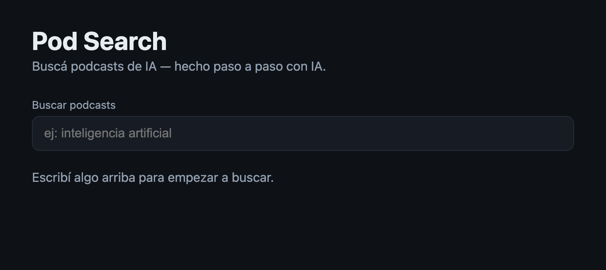

# Cómo se ve el paso 02 terminado

> **Y una nota de libertad:** todo lo de abajo es la vara del prompt **Advanced**
> (`prompt.md`, último bloque). Si jugaste con el Starter o el Medium, tu pantalla
> **no** tiene que parecerse a esta foto: ahí lo que vale es qué decidió la IA por su
> cuenta y qué le hubieras agregado al pedido. Para cuando quieras el resultado exacto
> del curso, pegá el Advanced.

## Debe estar

- [ ] Arriba, como en el paso 01: **Pod Search** y su subtítulo.
- [ ] Debajo, en gris chiquito, la etiqueta **Buscar podcasts**.
- [ ] Una caja de texto ancha (todo el ancho del contenido), fondo oscuro, borde
      redondeado, con el texto de ejemplo en gris adentro: `ej: inteligencia artificial`.
- [ ] Más abajo, el texto **Escribí algo arriba para empezar a buscar.**
- [ ] Podés tipear adentro de la caja y las letras aparecen.
- [ ] `npm test` → `Tests  3 passed (3)`.

## El detalle que delata que quedó bien

**Aún no hay ninguna lista.** En la foto, debajo del aviso no hay tarjetas ni nada: si
apareció una lista, tu IA se adelantó al paso 03. Y tipeá algo largo: la caja lo aguanta
y la pantalla no se rompe ni busca, porque todavía no sabe buscar.

## Si te quedó distinto

Fijate si la etiqueta dice "Buscar podcasts" **tal cual**: los tests la buscan por ese
nombre y, si la IA escribió "Buscar" a secas, fallan. Si preferís comparar:
`git checkout step-02`, mirá `app/src/ui/SearchInput.tsx` y `app/src/app/App.tsx`, y
volvé con `git checkout -`.
