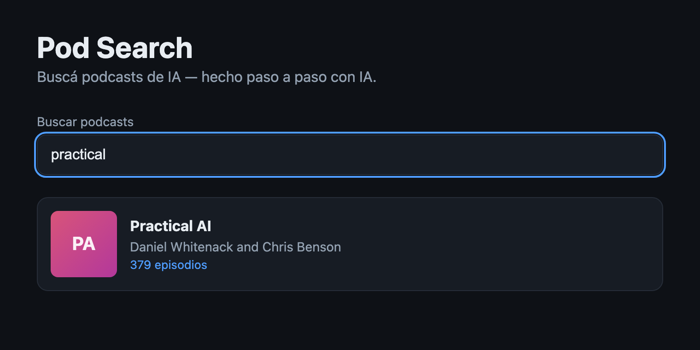

# Cómo se ve el paso 04 terminado

> **Y una nota de libertad:** todo lo de abajo es la vara del prompt **Advanced**
> (`prompt.md`, último bloque). Si jugaste con el Starter o el Medium, tu pantalla
> **no** tiene que parecerse a esta foto: ahí lo que vale es qué decidió la IA por su
> cuenta y qué le hubieras agregado al pedido. Para cuando quieras el resultado exacto
> del curso, pegá el Advanced.

## Debe estar

- [ ] La caja de búsqueda con la palabra `practical` escrita adentro y el **borde azul**
      de foco alrededor (la foto está tomada con la caja seleccionada).
- [ ] Una **sola** tarjeta en la lista: **Practical AI** (Daniel Whitenack and Chris
      Benson, 379 episodios). Las otras dos no están.
- [ ] `npm test` → `Test Files  3 passed (3)` y `Tests  15 passed (15)`.
- [ ] `npx vitest run src/application/filterPodcasts.test.ts` → `Tests  6 passed (6)`. Son
      los tests de la regla sola, sin React: en el resumen del final la parte de `tests`
      marca 1%, porque los 6 tests duran 1ms.
- [ ] En el repo existe `src/application/filterPodcasts.ts` y su `.test.ts` al lado.

## El detalle que delata que quedó bien

En la foto, la lista tiene **exactamente una tarjeta** con sólo escribir una palabra: el
filtro está vivo. Y el detalle más importante no se ve: los 6 tests de
`filterPodcasts.test.ts` pasaron **antes** de que la caja existiera, porque la regla vive
fuera de la pantalla. Si tu filtro está escrito dentro de `App.tsx`, los tests de la
función no pueden existir.

## Si te quedó distinto

Tipeá `diseno`: si no queda la lista vacía sin errores, falta normalizar tildes. Tipeá
`PRACTICAL` (mayúsculas): tiene que filtrar igual. Y para comparar:
`git checkout step-04`, mirá `app/src/application/filterPodcasts.ts` y su test; volvé con
`git checkout -`.
