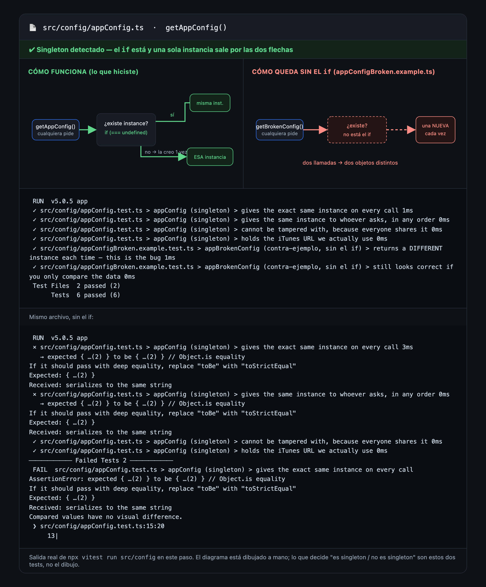

# Cómo se ve el paso 07 terminado

> **Y una nota de libertad:** todo lo de abajo es la vara del prompt **Advanced**
> (`prompt.md`, último bloque). Si jugaste con el Starter o el Medium, tu pantalla
> **no** tiene que parecerse a esta foto: ahí lo que vale es qué decidió la IA por su
> cuenta y qué le hubieras agregado al pedido. Para cuando quieras el resultado exacto
> del curso, pegá el Advanced.

## Debe estar

- [ ] `npx vitest run src/config` → `6 passed` en 2 archivos, así tal cual:
      `appConfig (singleton)` con 4 tests y `appBrokenConfig (contra-ejemplo, sin el if)` con 2.
- [ ] `npm test` → `30 passed` (7 archivos). Seis más que en el paso 06: los cuatro del
      singleton más los dos del contra-ejemplo.
- [ ] `src/config/appConfig.ts` con una variable `instance` **afuera** de la función y un
      `if (instance === undefined)` adentro.
- [ ] `src/infrastructure/itunesRepository.ts` **sin** la cadena `https://itunes.apple.com/search`:
      la pide con `getAppConfig()`.
- [ ] En la captura de la app: título **Pod Search**, la caja con "inteligencia artificial" y
      la lista larga de resultados reales (Inteligencia Artificial, IA al día, Inteligencia
      Artificial para los Negocios, Big Data e Inteligencia Artificial…), cada uno con
      cantidad de episodios en azul. La pantalla se ve igual que en el paso 06: a propósito.

## El detalle que delata que quedó bien

Dos llamadas a `getAppConfig()` devuelven la **misma instancia**, no dos objetos parecidos.
Eso sólo lo ve `toBe`; `toEqual` aprueba a los dos. La prueba concreta: en
`appConfigBroken.example.test.ts` los dos tests pasan al mismo tiempo — `not.toBe` y
`toEqual` sobre los mismos dos objetos. Ahí se ve con tus propios ojos que "los mismos
datos" y "el mismo objeto" no son la misma afirmación.

Si querés ver la versión roja (y deberías): sacá el `if` de `appConfig.ts` y corré otra vez
`npx vitest run src/config`. Vas a ver `2 failed | 4 passed`, con el mensaje
`expected { …(2) } to be { …(2) }` y un `Compared values have no visual difference` que es
la frase más pedagógica del paso. Después devolvé el archivo con `git checkout .`.

## Si te quedó distinto

Si tu `appConfig.ts` no tiene el `if`, compará con `git checkout step-07` (y volvé con
`git checkout -`). Si el config existe pero `itunesRepository.ts` sigue con la URL copiada,
pedile explícitamente: "usá `getAppConfig()` adentro de `searchITunesPodcasts`".
