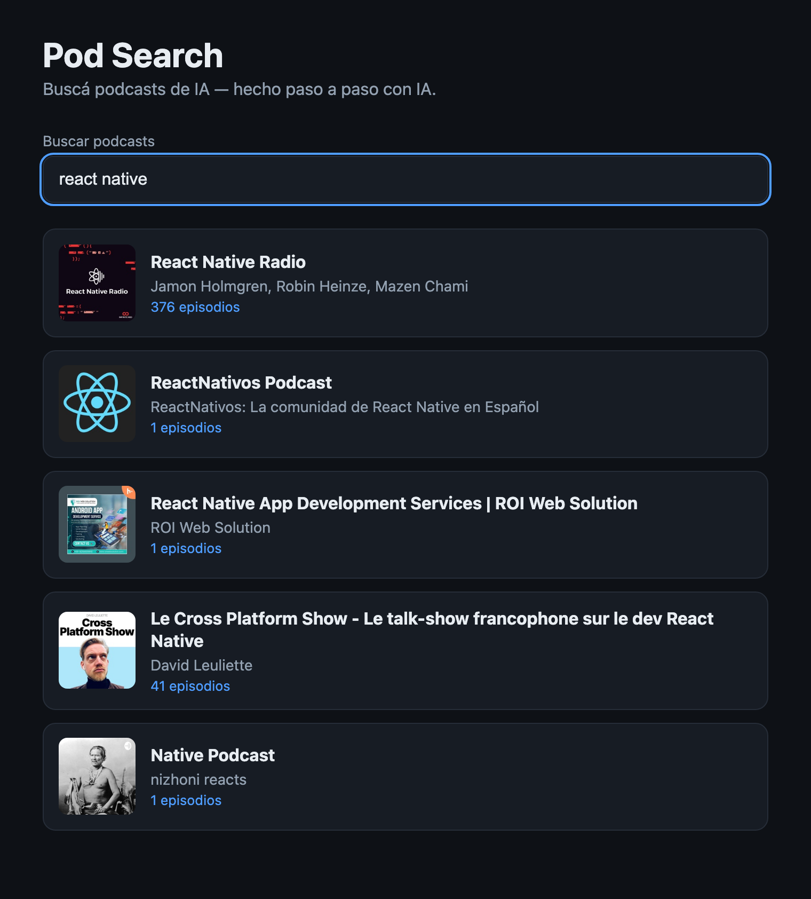

# Cómo se ve el paso 08 terminado

> **Y una nota de libertad:** todo lo de abajo es la vara del prompt **Advanced**
> (`prompt.md`, último bloque). Si jugaste con el Starter o el Medium, tu pantalla
> **no** tiene que parecerse a esta foto: ahí lo que vale es qué decidió la IA por su
> cuenta y qué le hubieras agregado al pedido. Para cuando quieras el resultado exacto
> del curso, pegá el Advanced.

## Debe estar

- [ ] `npx vitest run src/application` → `10 passed` en 2 archivos: los 6 del filtro que ya
      venías del paso 04 y los **4 nuevos** del caso de uso.
- [ ] `npm test` → `34 passed` (8 archivos). Cuatro más que en el paso 07.
- [ ] `grep -rn itunesRepository src/app/App.tsx` → **no devuelve nada**: la pantalla ya no
      importa a iTunes. Ese grep es el paso entero.
- [ ] `src/app/container.ts` con una sola línea de alambre:
      `createSearchPodcasts(itunesPodcastRepository)`.
- [ ] La pantalla: la caja con "react native" y las mismas tarjetas del paso 06 (React
      Native Radio, ReactNativos Podcast, React Native App Development Services, Le Cross
      Platform Show, Native Podcast). Ese es el punto: buscás y se ve igual que antes.

## El detalle que delata que quedó bien

**La imagen de este paso es la misma foto del paso 06, bit a bit.** No es un descuido: si
el refactor hubiera cambiado algo en la pantalla, la foto tendría que ser distinta. Acá
ganaste capacidad de cambiar iTunes por otra cosa sin tocar la UI, y eso no se ve.

Lo que sí tenés que poder señalar con el dedo: `searchPodcasts.test.ts` prueba la regla del
término vacío con un objeto falso, sin `fetch` y sin React. Ese test es la prueba de que el
puerto no es decorativo.

## Si te quedó distinto

Si `App.tsx` sigue mencionando iTunes, o si el caso de uso importa el repositorio, compará
contra `git checkout step-08` (y volvé con `git checkout -`). Si en cambio la pantalla se
ve distinta al paso 07, pedile a la IA que vuelva a dejarla igual: este paso no toca la UI.
